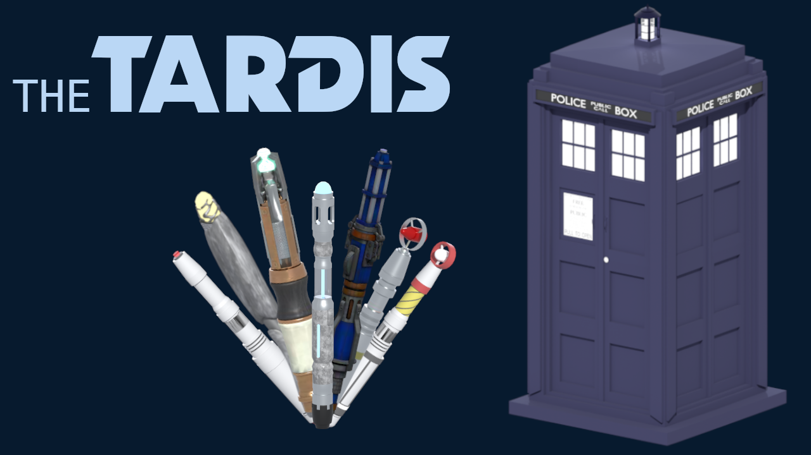
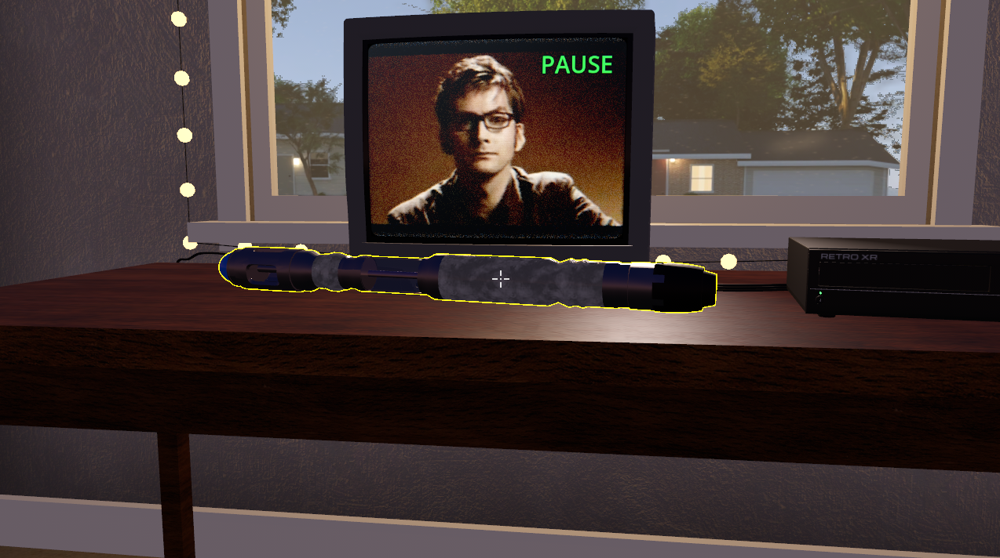
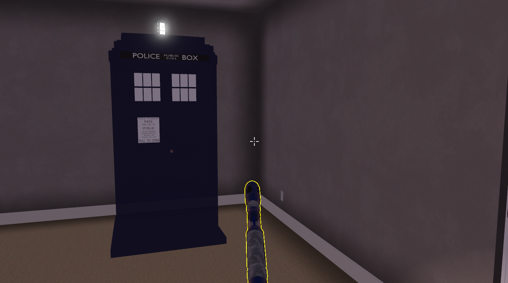
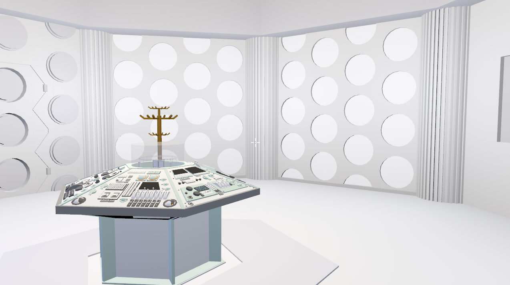

# TARDIS XR (`xenu.tardis`)

A [RetroXR](https://mod.io/g/retroxr/) mod: the Doctors' **Sonic Screwdriver** (the 2nd, 3rd, 4th, 5th, 10th, 11th, 12th and
13th), a **TARDIS** you summon with it, and the **console rooms** behind its door (the 1st and the 10th Doctor's).

> Beta software, and an unofficial fan mod: Doctor Who, the TARDIS and the sonic screwdriver are trademarks of the BBC.

## Screenshots

*The screwdriver: spawn it from SPAWN > Objects, pick it up, hold A / the trigger (Shift + click on a desktop).*

*Held a second on nothing the screwdriver calls a TARDIS; held on it, it sends it away.*

*Press the TARDIS's door and you are in a console room (the 1st Doctor's by default).*

## What it does

One row on SPAWN > Objects, "Sonic Screwdriver". Pressed it spawns the 10th Doctor's; HELD it asks which, as a console's row
asks for its colour. That needs the RetroXR patch in `tools/retroxr-mod-object-variants.patch` (`git apply` it in RetroXR);
a RetroXR without it offers the 10th Doctor's alone.

Pick it up and hold **A** (X on the left hand), or the trigger, or on a desktop Shift + left click. A hint floats over it
while you hold it and says so. It hums for as long as the button is down, and its light comes on if its Doctor's has one in the
show (10th: blue tip, 11th: green, 13th: amber crystal).

It is also a remote: aim it at (the device wears an outline as soon as it is aimed at) and keep it pointed at a TV, a VCR or any other device the TV remote drives, button down, for about a second
without a break, and it presses that device's power key (on, or off). The device is outlined while aimed at. Pointing at nothing
it just hums.

## Installing

Put `xenu.tardis-<version>.zip` (from the releases, or mod.io) in your RetroXR data folder under `mods/` (`~/retroxr/mods/` on a
desktop), enable it on the MODS tab and restart the game. Developing: `python3 tools/pack.py` builds, verifies and deploys it.

## Credits and licences

- 10th Doctor's screwdriver: "Sonic Screwdriver 10th Doctor" by Samantha Michelson (Sketchfab), CC BY 4.0.
- 5th Doctor's screwdriver: "Classic Styled Sonic ScrewDriver" by GawkyDevotee86 (Sketchfab), CC BY 4.0.
- 10th Doctor's console room: the interior of "TARDISY V2 Beta1" by Krauterz, used on condition that Krauterz is credited
  for the interior in the credits of any game that uses it: this is that credit.
- The other models and the sounds: author and licence not recorded yet, see `CREDITS.txt` in the repository (it lists each model and
  what was changed). They are to be filled in before the mod is made public.

## Notes for developers

Authored in a RetroXR checkout (`RetroXR/mods/xenu.tardis`, a symlink to this repo), so this folder
is its own git repository.

- `mod.json`, `mod_main.gd` the manifest and the entry (registers the object)
- `scripts/sonic_screwdriver.gd` the pickable: model and sound loaded at run time, A/trigger, LED
- `scripts/screwdriver_models.gd` the eight models: labels, light, the picker's rows
- `scripts/tardis.gd`, `scenes/tardis.tscn` the TARDIS: materialising, handling, door, power-key for the remote
- `scripts/tardis_summon.gd` where it lands (physics queries) and the failure sound; `tardis_exteriors.gd` its models
- `scripts/console_room.gd`, `scenes/console_room_10.tscn` the room (built from `models/interior/10.glb` + `10.json`); `console_rooms.gd` its table; `console_menu.gd`, `console_panel.gd`, `console_menu_2d.gd` the console and its menu; `tardis_travel.gd` in and out; `tardis_settings.gd` what the player chose
- `scripts/mod_assets.gd` reading GLB and MP3 at run time (shared)
- `scenes/sonic_screwdriver.tscn` its body, collision and pointer area
- `models/screwdriver/<id>.glb` the models, made by `tools/build_models.py` (`convert_screwdriver.py` does each one)
- `assets/audio/screwdriver.mp3` the hum
- `tools/pack.py` builds `build/xenu.tardis.zip` (with `tools/pack_mod.py`, the release workflow's packer) and deploys it to `~/retroxr/mods/`
- `tools/render_cutouts.py` renders the TARDIS and every screwdriver on a transparent background (for the thumbnail's collage)
- `tools/convert_screwdriver.py`, `make_thumbnail.py`, `render_lineup.py` Blender scripts (run with `blender -b -P`)
- `tests/screwdriver_tests.tscn`, `tardis_tests.tscn`, `console_tests.tscn` the suites; `tests/render_probe.tscn` screenshots, off and lit
- `CREDITS.txt` who made what, and under which licence

THE TARDIS. Hold the screwdriver's button for a second on nothing and a TARDIS lands in front of you: it does not
move, it forms where it stands: it switches on and off like a light, almost fully on and almost fully off, with the
landing sound (every 2 s), the off phases ever shorter, until it stays solid a little before the sound peaks (the
same backwards on takeoff). While it is see-through it is still solid: only the
nearest surface is drawn, so you never see the inside or the far side through it, and it looks exactly as it does
when solid (no change when it finishes; the last stretch is a gentle rise).
If there is no room there, it lands in the nearest spot in sight; if there is no room at
all, the landing sound is cut off by a buzz and nothing comes. Only one TARDIS to a room. Once it has landed it
is kept like an arcade cabinet (saved in the room's slot, back where you left it) until you send it away: hold the
screwdriver on it for a second, aimed at its middle, and it takes off. Take it by holding the grab on it for a second; aim at the floor and a
yellow rectangle shows where it will stand; let go and it vanishes and lands again there. Press its door
(trigger in VR, click on a desktop): it opens a crack and shuts, and what you see in the opening is a white light, and then you are in the console room. The white of its windows and of the lettering is lit (a medium glow, as the lantern's light above). Delete it (the bin, the item menu, the SCENE tab) and it takes off, with the sound and the blinking, and is then gone for good. It lands about 3 m ahead of you when there is room, and as near to that as the room allows when there is not.
It is also on SPAWN > Objects as "TARDIS".

THE CONSOLE ROOMS. Two, and the 1st Doctor's is the default: a bright white octagonal room, 9 m between its walls,
white roundels, a pale green hexagonal console under a clear rotor tube, a coat stand, the door a blue-grey panel
behind you. The 10th Doctor's (a domed coral room, 13 m across, the model drawn at 0.7) is dark, lit as in the
photographs of the 2005-2010 set: amber roundels, a cyan glow from the rotor and from under the console, and its door
is a white light in the doorway. You come in at the door and face the console, and every console room hums (interior-hum.mp3, looped; a switch in the console's menu turns it off, and the choice is kept). Point at the console and press the left thumbstick (Tab on a desktop) for its menu, which floats on the console itself:
which console room the TARDIS door leads to, reset this room (removes what you put in it; it asks twice),
which exterior the TARDIS wears, and the hum. The door (trigger / click) takes you out: back to the room you came from,
standing in front of the TARDIS, facing away from it, as if you had stepped out; if the room did not keep
the TARDIS (a "clean" slot is not saved) one is put back where it was. What you put in a console room is
saved like in any room with slots. Restart the game inside one and you are in it (RetroXR remembers the last
room, and falls back to its default room if this mod is gone); the way out is then that default room.
Its room is registered as a secret one (`hidden`) but RetroXR cannot hide a mod's room yet, so for now
it is a card in the SCENE tab too.

Built: the eight screwdrivers (spawn, hold, hum, light), the screwdriver as a remote (a second on a device
= its power key), the pack.
the TARDIS exterior (summon, materialise, handle, door, send away), the 1st and 10th Doctors' console rooms with
their doors, console menu and settings.
Not built: hiding the
console room from the SCENE tab (needs RetroXR), the other interiors (13, Church of Silence), a better
dome (its panels are coarse), the screen and rotor effects, the time vortex.

Budget (Quest 3): at most 6000 triangles and 8 meshes per screwdriver, textures at 256 px, 120-380 KB each.
